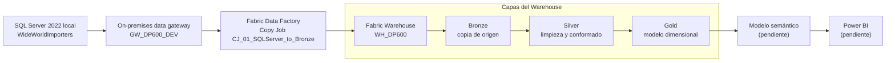

# Arquitectura general de la PoC

## Propósito

Esta prueba de concepto demuestra un flujo analítico de extremo a extremo con Microsoft Fabric, utilizando WideWorldImporters como origen transaccional en SQL Server 2022 local. El alcance es educativo y está orientado a construir un portfolio de capacidades relacionadas con DP-600.

## Arquitectura actual

## Componentes configurados

| Componente | Identificador / detalle | Función |
|---|---|---|
| Workspace de Fabric | `DP-600` | Espacio de trabajo del laboratorio |
| Warehouse | `WH_DP600` | Almacenamiento analítico SQL |
| SQL Server de origen | `MIEQUIPO\\SQLEXPRESS` | Base de datos transaccional local |
| Base de datos | `WideWorldImporters` | Origen de los datos |
| Gateway | `GW_DP600_DEV` | Conectividad desde Fabric al SQL Server local |
| Conexión | `CN_SQLSERVER_WWIMPORTERS_DEV` | Conexión utilizada por la ingesta |
| Copy Job | `CJ_01_SQLServer_to_Bronze` | Copia de tablas del origen a Bronze |

## Flujo de datos

1. Los datos de WideWorldImporters residen en SQL Server 2022 local.
2. El gateway permite que el servicio de Fabric alcance el origen local.
3. Un Copy Job de Data Factory copia las tablas seleccionadas a la capa Bronze del Warehouse.
4. Las transformaciones SQL generan tablas Silver con tipos y granularidad controlados.
5. La capa Gold contiene dimensiones y una tabla de hechos con un modelo en estrella.
6. La creación del modelo semántico y el informe Power BI forman parte de las siguientes fases; todavía no se consideran implementados.

## Capas Medallion

- **Bronze:** copia de datos de origen. Se conserva como zona de aterrizaje; puede contener duplicados de cargas repetidas.
- **Silver:** datos seleccionados, tipados, depurados y con granularidad validada.
- **Gold:** modelo dimensional preparado para el análisis.

Medallion describe una organización lógica de las transformaciones y la calidad de los datos. No es sinónimo de OneLake ni de un tipo de almacenamiento.

## Estado y alcance

La ingesta Bronze, las tablas Silver, las dimensiones Gold y `FactSales` están creadas y validadas. El modelo semántico, Power BI y la implementación funcional de SCD Tipo 2 están pendientes.

## Evidencias recomendadas

Consulta `../evidencias-arquitectura.md` para la lista de capturas que conviene incorporar al repositorio.
