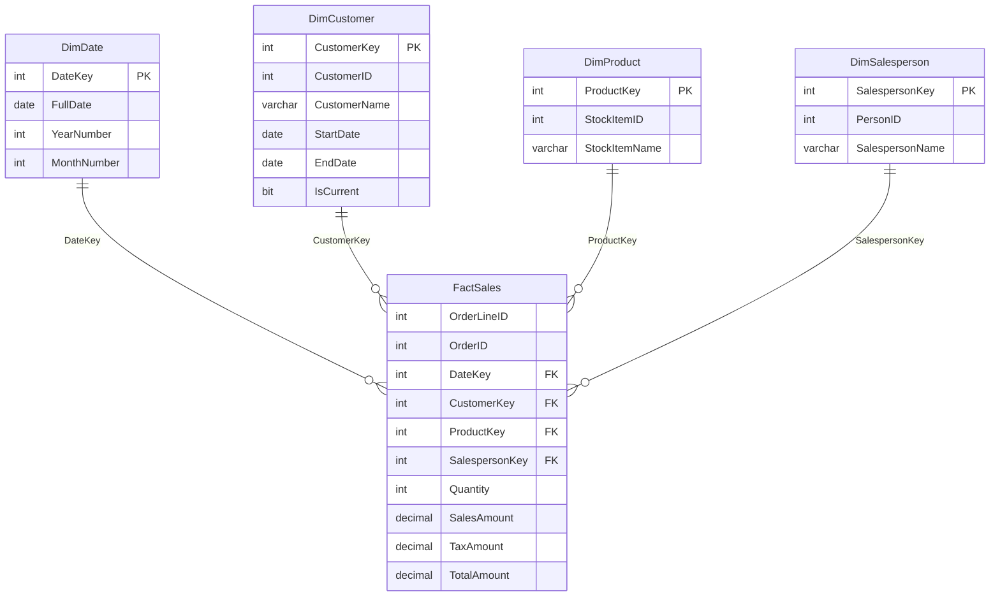

# Modelo dimensional Gold

## Enfoque

La capa Gold implementa un modelo dimensional en estrella basado en la metodología Kimball. La tabla de hechos registra ventas a nivel de línea de pedido y se relaciona con dimensiones mediante claves sustitutas.

## Grano de la tabla de hechos

`gold.FactSales` tiene una fila por cada `OrderLineID` de origen. Este grano debe mantenerse explícito al interpretar métricas y diseñar medidas.

## Tablas

| Tabla | Tipo | Contenido |
|---|---|---|
| `gold.FactSales` | Hechos | Cantidad, precio unitario, importe de venta, impuesto e importe total |
| `gold.DimDate` | Dimensión | Atributos de calendario |
| `gold.DimCustomer` | Dimensión | Atributos descriptivos del cliente |
| `gold.DimProduct` | Dimensión | Atributos descriptivos del producto |
| `gold.DimSalesperson` | Dimensión | Datos del vendedor |

`OrderID` se conserva en `FactSales` como dimensión degenerada. `OrderLineID` identifica la línea de pedido de origen.

## Diagrama lógico

## Validaciones realizadas

- `DimDate`: 1.247 fechas, desde 2013-01-01 hasta 2016-05-31.
- `DimCustomer`: 663 clientes en la carga inicial.
- `DimProduct`: 227 productos únicos.
- `DimSalesperson`: 10 vendedores.
- `FactSales`: 231.412 filas, una por línea de pedido.
- Comprobación de integridad referencial: cero hechos sin correspondencia en fecha, cliente, producto o vendedor.

Totales de la carga validada:

| Métrica | Valor |
|---|---:|
| Importe de venta | 177.634.276,40 |
| Impuestos | 26.588.038,98 |
| Importe total | 204.222.315,38 |

## Estado de SCD Tipo 2

`DimCustomer` contiene `StartDate`, `EndDate` e `IsCurrent`, pero la carga actual solo inicializa una versión por cliente. Todavía no existe un proceso de detección de cambios, cierre de versiones anteriores e inserción de nuevas versiones. Por tanto, la dimensión está preparada estructuralmente para una demostración SCD Tipo 2, pero SCD Tipo 2 no está implementado funcionalmente.

Además, la carga inicial de `FactSales` utiliza la versión actual del cliente. No debe afirmarse que los hechos históricos están asociados a la versión del cliente vigente en la fecha de cada venta.

## Seguridad analítica

La seguridad RLS/OLS para consumidores del modelo semántico se abordará en Power BI en una fase posterior. La seguridad del modelo semántico no sustituye a los permisos y controles del propio Warehouse para usuarios que accedan directamente a él.
